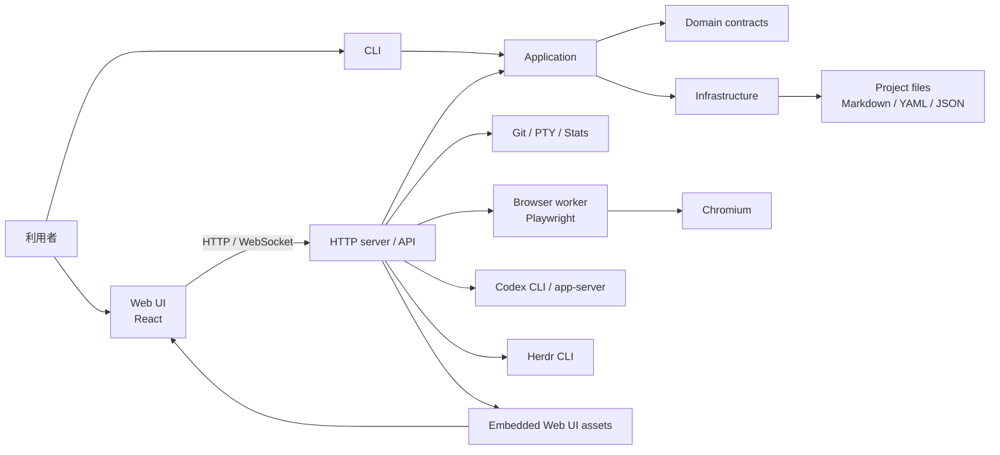

# システムアーキテクチャ

`mybox`はGo製のCLIとHTTPサーバー、React製Web UI、ファイルベースの永続化で構成されます。Web UIはビルド後にGoバイナリへ埋め込まれます。外部プロセス連携にはHerdr、Codex CLI/app-server、内部ブラウザworkerがあります。

## 責務とデータの流れ

- `cmd/mybox`がCLIの起動点です。serve起動時はentrypointがHTTP API、WebSocket、アプリケーション依存を組み立てます。
- `internal/application`はユースケースを実行し、`internal/domain`のモデルとインターフェースを使います。`internal/infrastructure`は設定、タスク、状態などのファイルベース実装を提供します。
- Web UIはHTTP APIとWebSocketを利用します。API契約の定義は`openapi.yaml`で、生成コードを直接編集しません。
- タスク、設定、UI状態などはファイルとして保存します。タスクはMarkdown、各種設定や状態は用途に応じてYAML/JSONを使います。
- ブラウザ操作はGo側のセッション管理からNode.js Playwright workerへ中継します。CodexとHerdrはローカルコマンド/プロセスとの連携です。

内部パッケージの依存方向はentrypointからapplication/domain/infrastructureへ、applicationからdomainへ向かいます。domainとapplicationはinfrastructureへ依存しません。

## 関連資料

- [`internal/README.md`](../internal/README.md) — Go内部層の案内。
- [`../openapi.yaml`](../openapi.yaml) — HTTP API契約。
- [`../browser-worker/README.md`](../browser-worker/README.md) — ブラウザworkerの構成と制約。
