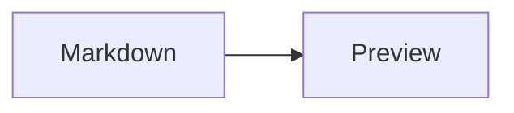

# Markdownとプレビュー仕様

FilesのMarkdownプレビューは`markdown-it`を基礎にした描画と、mybox独自のRichMarkdown処理で構成されます。対応範囲は次の実装に基づきます。

## Markdown

- 見出し、段落、リスト、引用、リンク、画像、表、コードブロックなど、Markdown-itが扱う標準的なMarkdownを表示します。
- RichMarkdownでは改行を反映し、URLの自動リンク化を有効にしています。HTML描画箇所はDOMPurifyでサニタイズされます。
- 相対Markdownリンクはプロジェクト内ファイルとして解決され、Filesで開けます。リンク先や描画箇所により変換動作が異なる場合があります。
- コードフェンスはPrismで対応言語をハイライトします。未対応言語はコードとして表示します。
- MermaidとVega-Liteは専用のコードフェンスを使います。編集画面の通常Markdown表示とは別にプレビューで描画します。

## Mermaid

Mermaidのコードフェンスは図として描画されます。

````markdown

````

図の拡大モーダルではスクロールで拡大・縮小し、ドラッグで表示位置を移動できます。描画エラー時はソースを確認できる表示に切り替わります。レンダラーはMermaidのstrict security levelを指定します。対応する図種や構文は同梱するMermaidのバージョンに従います。

## Vega-Lite

`vega-lite`コードフェンスの中にはVega-Lite仕様のJSONオブジェクトを記述します。

````markdown
```vega-lite
{
  "$schema": "https://vega.github.io/schema/vega-lite/v6.json",
  "data": {"values": [{"category": "A", "amount": 28}, {"category": "B", "amount": 55}]},
  "mark": "bar",
  "encoding": {
    "x": {"field": "category", "type": "nominal"},
    "y": {"field": "amount", "type": "quantitative"}
  }
}
```
````

仕様はJSONオブジェクトである必要があります。相対`data.url`はMarkdownファイルからの相対パスとして解決し、対応するローカルデータファイルを読み込みます。拡張子がCSV/TSV/DSV/JSON/TopoJSONの場合、format指定がなければ型を推定します。チャート操作メニューは無効で、SVG描画を使います。JSON解析や描画に失敗した場合はエラーとソースを表示します。

## 参照実装

- [`../web/src/components/RichMarkdown.tsx`](../web/src/components/RichMarkdown.tsx)
- [`../web/src/components/Mermaid.tsx`](../web/src/components/Mermaid.tsx)
- [`../web/src/components/VegaLite.tsx`](../web/src/components/VegaLite.tsx)
- [`../web/package.json`](../web/package.json) — 同梱ライブラリのバージョン範囲
